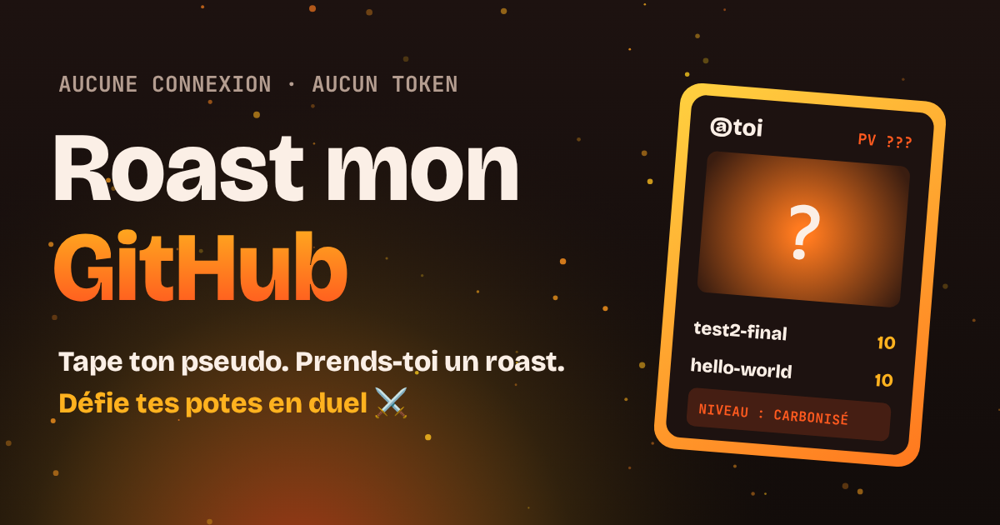

# 🔥 Roast mon GitHub

**Tape un pseudo GitHub. Prends-toi un roast. Défie tes potes.**

👉 **[Griller mon profil](https://cedricpoint.github.io/roast-mon-github/)**

## Ce que ça fait

- **Le roast** : l'app fouille ton profil public (repos, langages, horaires de push, noms de projets…) et te sert 6 punchlines bien senties, plus une note positive pour finir (on n'est pas des monstres).
- **Le niveau de cuisson** : 🥩 Saignant → 🍖 À point → 🔥 Bien cuit → ☠️ Carbonisé.
- **Ta carte de dev** façon carte à collectionner : PV, type selon ton langage principal (Python = Poison, Rust = Acier…), tes deux meilleurs repos en attaques, et ton roast vedette. Prête à poster.
- **Le mode duel** ⚔️ : deux pseudos, cinq manches (étoiles, abonnés, projets, ancienneté, activité), un gagnant, une carte à partager.
- **Les liens partageables** : `?u=pseudo` ouvre directement un roast, `?u=toi&vs=pote` lance le duel.

Quelques exemples de ce qui peut tomber :

> 🪦 « 72 % de tes projets n'ont pas bougé depuis plus d'un an. Ton GitHub, c'est un cimetière avec de la coloration syntaxique. »

> 🦉 « 41 % de tes pushs récents entre minuit et 5h. Ton code tourne au café et aux mauvaises décisions. »

> 🏷️ « Tu as un repo qui s'appelle « test2-final ». On sent l'ambition et la vision long terme. »

## Technique

- Un seul `index.html`, zéro dépendance, zéro build, zéro serveur.
- Données lues directement depuis l'API publique GitHub, dans ton navigateur : aucun token, aucune connexion, rien n'est stocké (juste un cache de session pour économiser les requêtes).
- Cartes dessinées en `<canvas>`, partage natif sur mobile (image + lien).
- Limite de l'API GitHub sans token : 60 requêtes par heure et par connexion, soit une vingtaine de roasts.

### Lancer en local

Ouvre `index.html` dans ton navigateur.

### Ajouter des punchlines

Tout est dans la fonction `roast()` et l'objet `LANG_ROASTS`. Les PR avec de nouvelles vannes sont les bienvenues (drôles, pas méchantes 🫶).

## Licence

MIT
